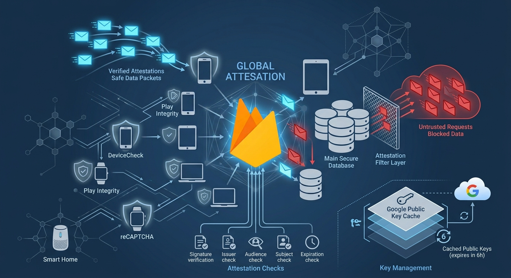

+++
date = '2026-10-01T00:00:00+02:00'
title = 'One before_action to Keep Bots Out: Firebase App Check in Rails'
author = 'Genry Wood'
tags = ['firebase', 'security', 'controller', 'spam', 'token', 'appcheck']
+++



## What if one line of code could stop a bot from ever reaching your database?

```ruby
before_action :verify_firebase_appcheck_token!
```

That line is the entire cost of protecting an endpoint. What it buys is a check most public APIs never bother with: proof that the request came from your actual app binary, and not from a script, a bot, or someone replaying your API from Postman after pulling the endpoint out of your mobile client.

## What one before_action can do

A JWT session token tells you **who** is calling. It says nothing about **what** is calling. Anyone with a valid session token - stolen, phished, or legitimately obtained - can hit your endpoints with curl all day, and your backend cannot tell your official app from a script hitting the same routes. Rate limiting and CAPTCHAs help, but they are reactive. They kick in after abuse has started, and both are easy to route around with rotating IPs or proxy pools.

Firebase App Check closes that gap. Each client app (Web, Android, IOS) is attested by the platform itself: Play Integrity on Android, DeviceCheck or App Attest on IOS, reCAPTCHA on web. In exchange, the client gets a short-lived signed token. Your backend's only job is to verify that Google signed that token for your Firebase project. It does not run any attestation logic. If the token does not check out, the request never reaches your controller logic.

This matters most on endpoints outside your normal auth wall: public signup forms, password-reset requests, "contact us" submissions, anything a client can call before it has a session token. Credential-stuffing bots, fake-account scripts and scrapers go after exactly these routes, because there is no session to gate them. App Check is a cheap, low-maintenance filter at the door, and it does not touch the logic of the endpoint it protects.

## Inside the Verification: Five Checks, Five Failure Modes

```ruby
def verify(token)
  return false unless token

  jwks = ::Auth::Token::GoogleFirebasePublicKeysCache.call
  payload, header = decode_token(token, jwks['keys'])

  return false unless header['alg'] == DECODE_ALGORITHM && header['typ'] == 'JWT'
  return false unless valid_iss(payload) && valid_aud(payload) && valid_sub(payload)
  return false unless payload['exp'] > Time.now.to_i

  true
end
```

Five conditions gate one boolean. Drop any one of them and you have built a decoder, not a verifier: the token parses fine, it just does not mean anything. Here is what each condition stops.

**1. Signature, via `decode_token` and the JWKS.** This does the heavy lifting before any of your own checks run. Passing `jwks:` to `JWT.decode` makes the gem match the token's `kid` header against Google's published key set and verify the RS256 signature with the right key. This is the check that proves the token was not forged. Skip it, and everything after is just reading fields off a JSON blob anyone could hand-craft.

**2. `alg` and `typ`, against algorithm confusion.** If you check the signature but skip the algorithm, an attacker can hand you a token signed with a different algorithm, weaker or attacker-controlled, and get it accepted. Pinning `alg` to RS256 and `typ` to JWT closes that door explicitly instead of trusting what the token claims about itself.

**3. `iss`, the issuer.**

```ruby
def valid_iss(payload)
  payload['iss'] == "https://firebaseappcheck.googleapis.com/#{FIREBASE_PROJECT_NUMBER}"
end
```

This confirms the token was issued for your project specifically. A valid, correctly signed App Check token from someone else's Firebase project passes every other check. This line stops it from being replayed against yours.

**4. `aud`, the audience.** It does the same job from the other direction. It checks that the audience names your project (`projects/#{FIREBASE_PROJECT_NUMBER}`) as an intended recipient. Google sends `aud` as an array, so compare with `include?` rather than `==`:

```ruby
def valid_aud(payload)
  Array(payload['aud']).include?("projects/#{FIREBASE_PROJECT_NUMBER}")
end
```

**5. `sub`, the registered app.** This is the most specific check in the list. The subject claim identifies which registered app requested the token, and the line below makes sure it is one of the three app IDs you actually issued: web, Android or iOS.

```ruby
def valid_sub(payload)
  web_app_id = Rails.application.credentials.firebase.web_app_id!
  android_app_id = Rails.application.credentials.firebase.android_app_id!
  ios_app_id = Rails.application.credentials.firebase.ios_app_id!

  [web_app_id, android_app_id, ios_app_id].include?(payload['sub'])
end
```

Without it, a token that is valid for `iss` and `aud` but belongs to some other app in the same Firebase project would still pass.

**The expiry check** is the last line and the easiest to get wrong by omission. App Check tokens are short-lived by design, so `payload['exp'] > Time.now.to_i` is what turns a stolen token into a liability with a shelf life instead of a permanent skeleton key. The jwt gem verifies `exp` on its own by default, which makes this line a second guard, not the only one. Keep it explicit anyway: if someone later passes `verify_expiration: false` while debugging, the method still holds.

Miss any single check and the method still runs, still returns true or false, and still looks like it is doing its job in a code review. The failure only shows up in production, as a request that should have been rejected.

## Wiring It Into a Controller

The verifier is a plain Ruby object. The controller layer only has to read one header and decide what to do with the answer. The client sends the App Check token in the `X-Firebase-AppCheck` header, which is the header Firebase documents for backend verification.

The filter itself lives next to `check_authentication!` in the base controller, so every controller in the namespace can opt in with one line:

**app/controllers/api/business/v1/api_controller.rb**

```ruby
def verify_firebase_appcheck_token!
  return if ::Auth::Token::FirebaseAppCheck.verify(appcheck_token_from_headers)

  head :unauthorized
end

private

def appcheck_token_from_headers
  request.headers['X-Firebase-AppCheck']
end
```

A missing header is handled by the first line of `verify` (`return false unless token`), so the controller does not need a separate nil check.

Then the controller that serves a public endpoint opts in. It follows the same shape as any other controller in the project:

**app/controllers/api/v1/test_controller.rb**

```ruby
# frozen_string_literal: true

module Api
  module V1
    class TestController < ApiController
      before_action :verify_firebase_appcheck_token!, only: :create

      def create
      end
    end
  end
end
```

- **Order.** Put the App Check filter before `check_authentication!` on endpoints that have both. It is cheaper to reject a bad client than to decode a session token first.
- **Status code.** `401` matches what `check_authentication!` already returns, so mobile clients handle one "not accepted" path. If you want to tell the two failures apart in logs, log a reason on the server side and keep the response body empty.

## Google's Public Keys: Fetch Once, Cache Carefully

Every check in the previous section depends on one thing you do not control: the key set Google signs with. It is published at `https://firebaseappcheck.googleapis.com/v1/jwks`. Fetching it on every request would add a network round trip to each protected call and make Google's endpoint part of your uptime. So `GoogleFirebasePublicKeysCache` exists, and it deserves as much thought as the verifier.

A minimal version looks like this (a sketch; adapt the path and the HTTP client to what your project already uses):

**app/services/auth/token/google_firebase_public_keys_cache.rb**

```ruby
# frozen_string_literal: true

module Auth
  module Token
    class GoogleFirebasePublicKeysCache
      JWKS_URL = 'https://firebaseappcheck.googleapis.com/v1/jwks'
      CACHE_KEY = 'firebase_appcheck_jwks'
      EXPIRES_IN = 6.hours

      def self.call
        Rails.cache.fetch(CACHE_KEY, expires_in: EXPIRES_IN) { fetch_keys }
      end

      def self.fetch_keys
        uri = URI(JWKS_URL)
        response = Net::HTTP.start(uri.host, uri.port, use_ssl: true, open_timeout: 2, read_timeout: 2) do |http|
          http.get(uri.request_uri)
        end

        JSON.parse(response.body)
      end

      private_class_method :fetch_keys
    end
  end
end
```

## Conclusion

A session token proves who is calling. App Check proves what is calling, and that is the question your public endpoints were never able to answer. The cost is one `before_action`, one small verifier and a cached key set. Get the five claims right, cache Google's keys with sane timeouts, and the cheap attacks (curl, Postman, scripts replaying your mobile API) stop at the door, before they touch a controller or your database.