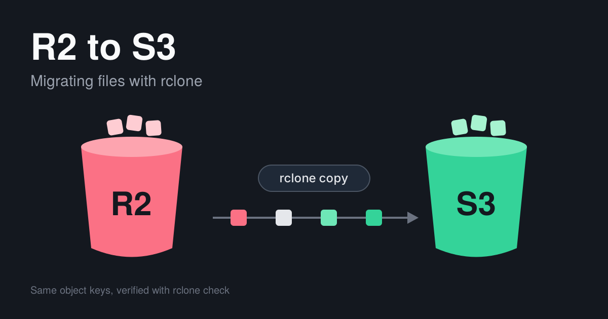

+++
date = '2026-10-28T11:14:00+02:00'
title = 'Migrating files from Cloudflare R2 to AWS S3 with rclone'
author = 'Genry Wood'
tags = ['aws', 's3', 'cloudflare', 'r2', 'rclone', 'migration']
+++



I had rails API that kept uploaded files in Cloudflare R2 next to AWS S3 was being moved onto a single storage setup: S3 as the origin, with CloudFront in front of it. The application code was one half of that change. The files were the other half. Every object that lived in R2 had to exist in S3 under the same key before the application could stop reading from R2, and the application kept serving requests the whole time.

A script that lists the bucket, downloads each object and uploads it again is the obvious first idea. For a one-time job it also means writing parallelism, retries and verification from scratch, and trusting them with production data. The tool found for this task was [rclone](https://rclone.org), a command-line program that copies files between storage systems. It describes each system as a named remote, and both R2 and S3 can be defined as remotes of type `s3`, because R2 exposes an S3-compatible API. Copying then becomes one command, and the same tool provides the dry run, retry and check options that a migration needs.

## Two remotes

rclone addresses storage through named remotes defined in its config file. R2 is configured as an S3 remote with the provider set to `Cloudflare`, and the endpoint contains the Cloudflare account id:

```ini
[r2]
type = s3
provider = Cloudflare
access_key_id = <r2_access_key>
secret_access_key = <r2_secret_key>
region = auto
endpoint = https://<cloudflare_account_id>.r2.cloudflarestorage.com/
```

The AWS side is a standard S3 remote with a region:

```ini
[aws]
type = s3
provider = AWS
access_key_id = <aws_access_key>
secret_access_key = <aws_secret_key>
region = eu-central-1
```

The R2 credentials need read access to the source bucket, and the AWS credentials need write access to the destination bucket. Before copying anything, both remotes can be tested by listing:

```bash
rclone lsf r2:my-bucket --max-depth 1
rclone lsf aws:my-new-bucket --max-depth 1
```

The destination bucket is created in AWS beforehand, with the region and access settings the application will need.

## Copy, not sync

rclone has two commands that look similar. `rclone copy` transfers files that are missing or changed at the destination and leaves everything else alone. `rclone sync` makes the destination identical to the source, which includes deleting files at the destination that do not exist in the source. A mistyped path with `sync` removes data, so every run in this migration uses `copy`. The consequence is that objects deleted from R2 during the migration stay in S3, which is harmless and can be cleaned up later.

Object keys are copied as they are. Database records that store keys or paths keep resolving after the switch, with no data changes on the application side.

## A trial run

A dry run lists what would be transferred and changes nothing:

```bash
rclone copy r2:my-bucket aws:my-new-bucket --dry-run --progress
```

A small prefix is then copied for real, to confirm that permissions, content types and the resulting URLs behave as expected:

```bash
rclone copy r2:my-bucket/avatars/ aws:my-new-bucket/avatars/ \
  --progress --transfers 32 --checkers 32
```

If objects carry custom metadata, `--metadata` (`-M`) has to be added. Without it rclone preserves only the modification time and the content type.

## The bulk copy

The full copy uses higher parallelism and retries, since a long run is likely to meet a few transient errors:

```bash
rclone copy r2:my-bucket aws:my-new-bucket \
  --progress --transfers 64 --checkers 64 \
  --fast-list --retries 10 --low-level-retries 20
```

`--transfers` sets how many files are copied at once, and `--checkers` how many are compared at once. `--fast-list` reduces the number of listing requests for buckets with many objects, at the cost of memory, so it is worth testing on the trial prefix first. R2 does not charge for egress bandwidth, so reading the whole bucket out of it does not add a bandwidth cost.

Files keep arriving in R2 while this runs. Running the same command again copies only what is new or changed, which makes it a delta sync. The command is repeated until a run finishes quickly, and once more immediately before the switch.

## Verifying

The first check is the object count and total size on both sides:

```bash
rclone size r2:my-bucket
rclone size aws:my-new-bucket
```

The second compares the objects themselves. `--one-way` checks that everything in the source exists in the destination and ignores extra files there:

```bash
rclone check r2:my-bucket aws:my-new-bucket --one-way --progress
```

Hash comparison has a limit that matters for large files. For a file uploaded in parts, the ETag in S3 is not the MD5 of the file. It is derived from the MD5 of each part and the number of parts, so it depends on the part size that was used. A comparison based on ETags can therefore report differences for files that are identical. For a sample of such files, `--download` makes rclone download both copies and compare the content directly, streaming through memory without writing to disk:

```bash
rclone check r2:my-bucket/videos aws:my-new-bucket/videos --one-way --download
```

Downloading everything this way is slow and transfers the whole bucket twice, so it is reserved for the large objects or for a random sample.

## The switch

The cutover is a configuration change in the application: the storage endpoint, the bucket name and the credentials point to AWS instead of R2. Because the keys are identical, existing records need no changes. The order is:

1. Run the final delta copy, ideally with uploads paused for the duration.
2. Run `rclone check` once more.
3. Deploy the configuration that points to S3.
4. Keep the R2 bucket untouched for a while, so a rollback is a configuration change and not another migration.

Deleting the R2 bucket is the last step, after the application has run on S3 long enough to expose anything that was missed.

## Summary

A bucket moves from R2 to S3 with two rclone remotes and `rclone copy`, repeated as a delta until the final run before the switch, then confirmed with `rclone check`, with `--download` for large multipart files, and the R2 bucket stays in place until the application has proven itself on S3.