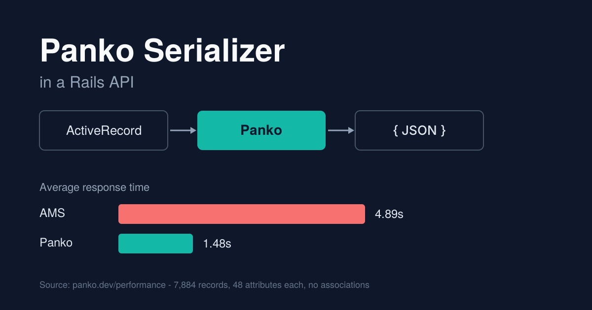

+++
date = '2026-10-04T00:00:00+02:00'
title = 'Panko Serializer in a Rails API'
author = 'Genry Wood'
tags = ['serializer', 'panko', 'rails', 'gem', 'response']
+++



The Panko documentation publishes a benchmark that serializes 7,884 records with 48 attributes each and no associations. The endpoint using ActiveModelSerializers (AMS) averaged 4.89 seconds per response. The same endpoint with Panko averaged 1.48 seconds.

| Metric             | AMS   | Panko |
| ------------------ | ----- | ----- |
| Avg response time  | 4.89s | 1.48s |
| Total requests     | 61    | 202   |

These numbers come from the Panko project itself and were measured in its own environment with `wrk`, so they show the order of magnitude and not a guarantee for any other application. The microbenchmarks on the same page point in the same direction, with Panko 0.8.0 serializing 2,300 simple posts about 45 times faster than AMS 0.10.13 on Ruby 3.2.0 and Rails 7.0.5.

This article covers what Panko is, how to define serializers, how to render them from an API controller, and how to avoid N+1 queries.

## What Panko is

Panko is a gem for serializing ActiveRecord and plain Ruby objects to JSON strings. Its syntax is inspired by ActiveModelSerializers. According to the project documentation, the speed comes from three things:

- Oj. Panko uses Oj to build JSON and relies on `Oj::StringWriter` for incremental serialization.
- Serialization descriptor. Most of the metadata about a serializer is computed once ahead of time instead of on every record.
- Type casting. Panko casts attribute types itself instead of going through ActiveRecord.

## Setup

Add the gem to the `Gemfile` and run `bundle install`:

```ruby
gem 'panko_serializer'
```

A serializer inherits from `Panko::Serializer`. A shared base class is a common convention and gives one place for behavior that all serializers need:

```ruby
# frozen_string_literal: true

class ApplicationSerializer < Panko::Serializer
end
```

## Defining a serializer

The simplest serializer lists the columns to include:

```ruby
# frozen_string_literal: true

module Api
  module V1
    class AuthorSerializer < ApplicationSerializer
      attributes :id, :name
    end
  end
end
```

Attributes that map to columns are called field attributes. Panko reads and type casts them itself.

Values that are not columns are defined as methods on the serializer. The record is available as `object`:

```ruby
# frozen_string_literal: true

module Api
  module V1
    class CommentSerializer < ApplicationSerializer
      attributes :id, :body, :author_name

      def author_name
        "#{object.author.first_name} #{object.author.last_name}"
      end
    end
  end
end
```

To expose a column under a different name, use `aliases` instead of a method. A method that returns `object.created_at` skips Panko's type casting, while an alias keeps it:

```ruby
aliases created_at: :published_at
```

Nested objects are declared with `has_one` and `has_many`:

```ruby
# frozen_string_literal: true

module Api
  module V1
    class PostSerializer < ApplicationSerializer
      attributes :id, :title, :body

      has_one :author, serializer: Api::V1::AuthorSerializer
      has_many :comments, each_serializer: Api::V1::CommentSerializer
    end
  end
end
```

Panko can infer the serializer class from the association name, but the lookup uses `Object.const_get` with the singularized name and a `Serializer` suffix. For serializers placed inside modules, as above, the class has to be passed explicitly.

## Rendering in a controller

A collection is wrapped in `Panko::ArraySerializer`. Passing it directly to `render json:` works for a bare array, but an API response usually carries pagination metadata next to the data. Converting the serializer result to a string with `to_json` and putting it inside a hash would produce a JSON string nested in a JSON string. `Panko::Response` exists for this case and embeds the serializer output as JSON:

```ruby
# frozen_string_literal: true

module Api
  module V1
    class PostsController < ApiController
      before_action :check_authentication!

      def index
        posts = Post.includes(:author, :comments)
          .page(params[:page]).per(params[:per_page])

        render json: Panko::Response.new(
          data: Panko::ArraySerializer.new(posts, each_serializer: Api::V1::PostSerializer),
          meta: pagination_meta(posts)
        )
      end
    end
  end
end
```

For a single object, `Panko::Serializer` does not accept the record in its constructor, so `Panko::Response.create` is used with the `serializer` helper:

```ruby
def show
  post = Post.includes(:author, :comments).find(params[:id])

  render json: Panko::Response.create { |r|
    { data: r.serializer(post, Api::V1::PostSerializer) }
  }
end
```

If a serialized fragment is already stored as a JSON string, for example in a cache, `Panko::JsonValue.from(cached_string)` places it into the response without parsing it again.

## Context

A serializer often needs data that is not part of the record, such as the current user or a set of feature flags. The `context` option passes a hash into the serializer, where it is available as `context`:

```ruby
# frozen_string_literal: true

module Api
  module V1
    class PostSerializer < ApplicationSerializer
      attributes :id, :title, :editable

      def editable
        object.author_id == context[:current_user].id
      end
    end
  end
end
```

```ruby
Panko::ArraySerializer.new(
  posts,
  each_serializer: Api::V1::PostSerializer,
  context: { current_user: current_user }
)
```

## Avoiding N+1 queries

I've hit this issue few times, so it should be note. A serializer reads associations from the record it receives. If the association is not loaded, every record triggers its own query. A method attribute that touches `object.author`, like `author_name` above, has the same effect.

The fix is to preload everything the serializer uses before the collection is passed in:

```ruby
posts = Post.includes(:author, :comments)
```

The Panko getting started guide uses the same approach with `User.includes(:posts)`. When a filter object builds the relation, the `includes` call belongs at the end of the chain, so the list of preloaded associations stays next to the serializer that requires it.

## Summary

Panko is a serializer with an AMS-like syntax that builds JSON through Oj and its own type casting, and in an API it is used by defining serializers per resource, wrapping collections in `Panko::ArraySerializer` and `Panko::Response`, and preloading associations with `includes` to avoid N+1 queries.