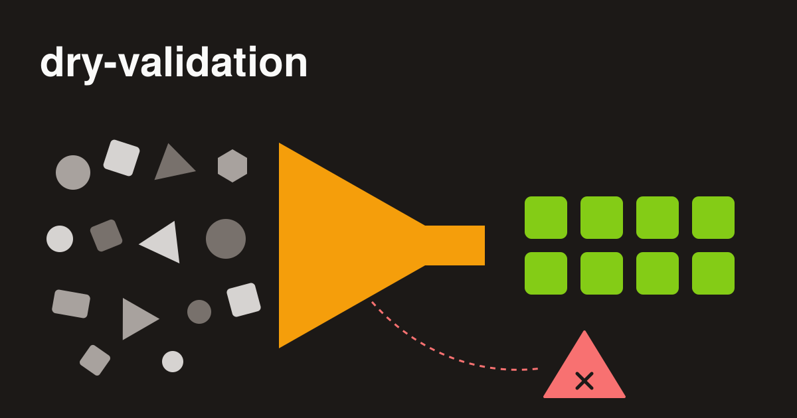

+++
date = '2026-06-1T00:00:00+02:00'
title = 'Validating API input with dry-validation'
author = 'Genry Wood'
tags = ['api', 'validation', 'ruby', 'rails', 'dry', 'dry-validation']
+++



An endpoint that creates events receives a request body, and the controller has to decide whether it can be trusted before anything is saved. The body is a hash that nobody has checked: a date arrives as a string, a number may arrive as text, a required key may be missing, and a field that should be a hash may be an array. ActiveRecord validations cover part of this, but they run when a record is saved, on attributes that were already assigned and typed. By that point the input has been trusted for the whole length of the request.

[dry-validation](https://github.com/dry-rb/dry-validation) addresses this earlier. It checks the raw input in a separate object, converts the values to the expected types, and returns either clean data or a structured list of errors. This article builds one contract step by step, starting from the input that causes problems and adding a layer at each step.

## The input

A request to create an event might look like this once Rails has parsed it:

```ruby
{
  title: 'Launch',
  start_date: '2026-12-01',
  end_date: '2026-11-30',
  guests: '40'
}
```

Every value is a string. `start_date` has to be a date, `guests` has to be an integer, and `end_date` is earlier than `start_date`, which is valid as a type but not as a booking. Some of these problems concern the shape of the data and some concern its meaning, and dry-validation keeps the two apart: a contract has a schema for the first kind and rules for the second.

## Schema: shape and types

The schema describes which keys are expected and what values they may hold. It is powered by dry-schema, which sanitizes, coerces, and type-checks the input. With `params`, values that arrive as strings are converted to the declared types.

```ruby
# frozen_string_literal: true

class EventCreateContract < Dry::Validation::Contract
  params do
    required(:title).filled(:string, max_size?: 100)
    required(:start_date).value(:date)
    required(:end_date).value(:date)
    optional(:guests).value(:integer)
  end
end
```

Calling the contract with the input above returns a result in which `start_date` and `end_date` are `Date` objects and `guests` is the integer `40`. The calling code does not parse anything itself.

`required` and `optional` describe the key: a required key must be present, an optional one may be missing. The macro that follows describes the value. `filled` rejects `nil` and, for strings, hashes and arrays, empty values. `maybe` accepts `nil`, which is a different question from whether the key exists. `value` adds only the checks listed in it, so `value(:integer, gt?: 18)` means an integer greater than 18 and nothing else, with no special treatment of `nil`. Predicates such as `max_size?` and `gt?` are passed as options and combined with the type check.

When the schema fails, the errors say which key and why:

```ruby
EventCreateContract.new.call(title: '', start_date: 'oops').errors.to_h
# => { title: ['must be filled'], start_date: ['must be a date'], end_date: ['is missing'] }
```

## Rules: what the data means

A date can pass the schema and still be unacceptable. Checks like this go into rules. A rule is attached to a key, receives its value as `value`, and adds an error with `key.failure`:

```ruby
rule(:start_date) do
  key.failure('must be in the future') if value <= Date.today
end
```

Rules run after the schema, in the order they are defined, and a rule is executed only when the schema successfully processed the keys it depends on. This is why the rule above can compare `value` with `Date.today` without checking the type first: if `start_date` had not been a date, the rule would have been skipped and only the schema error would be reported.

For an optional key, `key?` tells whether it was present at all:

```ruby
rule(:guests) do
  next unless key?

  key.failure('must be positive') if value <= 0
end
```

### Comparing fields

The example input has a problem that no single field shows: the event ends before it starts. A rule that depends on several keys lists all of them and reads them from `values`:

```ruby
rule(:end_date, :start_date) do
  key.failure('must be after start date') if values[:end_date] < values[:start_date]
end
```

Without arguments, `key.failure` targets the first key of the rule, here `end_date`. Another key can be targeted with `key(:start_date).failure(...)`. As with a single-key rule, this one is skipped if the schema failed for either date.

Some failures belong to the request as a whole and not to a field. `base.failure` is used for these, inside a rule that has no keys:

```ruby
rule do
  base.failure('creating events is allowed only on weekdays') if Date.today.on_weekend?
end
```

Such an error is stored under the `nil` key in the errors hash.

## The result

Putting the pieces together and calling the contract with the original input:

```ruby
result = EventCreateContract.new.call(
  title: 'Launch', start_date: '2026-12-01', end_date: '2026-11-30', guests: '40'
)

result.success?     # => false
result.errors.to_h  # => { end_date: ['must be after start date'] }
result.to_h         # => { title: 'Launch', start_date: #<Date: 2026-12-01>, end_date: #<Date: 2026-11-30>, guests: 40 }
```

`success?` answers whether the input passed. `errors.to_h` is a hash keyed by field and can be rendered as the body of a 422 response. `to_h` contains the values after coercion, which is what the rest of the code should work with.

## Messages

A string passed to `key.failure` is the simplest form of a message. It can also carry metadata, which is useful when a client needs a machine-readable code next to the text:

```ruby
key.failure(text: 'must be greater than 18', code: 123) if values[:age] < 18
# errors.to_h => { age: [{ text: 'must be greater than 18', code: 123 }] }
```

Messages that are reused or translated belong in a locale file under the `dry_validation` namespace, and a rule refers to them with a symbol:

```yaml
en:
  dry_validation:
    errors:
      rules:
        age:
          invalid: "must be greater than 18"
```

```ruby
rule(:age) do
  key.failure(:invalid) if values[:age] < 18
end
```

The files are registered in the contract configuration. Setting this on a shared base class applies it to every contract in the application:

```ruby
class ApplicationContract < Dry::Validation::Contract
  config.messages.load_paths << 'config/errors.yml'
  config.messages.default_locale = :en
end
```

`config.messages.backend` selects the localization backend, `:yaml` or `:i18n`, and `config.messages.top_namespace` changes the key under which messages are looked up. Overrides for schema predicates go into the same namespace as rule messages.

To include the field name in the text, the display name is defined in the locale file and requested with `errors(full: true)`:

```yaml
en:
  dry_validation:
    rules:
      title: "Event title"
```

```ruby
contract.call(title: '').errors(full: true).to_h
# => { title: ['Event title must be filled'] }
```

## Nested input

Some payloads contain nested objects and lists. A nested hash is declared with `hash do ... end` on a key, and a list of hashes with `array(:hash) do ... end`:

```ruby
# frozen_string_literal: true

class BookingCreateContract < ApplicationContract
  params do
    required(:venue).hash do
      required(:city).filled(:string, min_size?: 3)
      required(:country).hash do
        required(:code).filled(:string)
      end
    end

    required(:guests).array(:hash) do
      required(:name).filled(:string)
      required(:age).filled(:integer, gt?: 17)
    end
  end
end
```

Errors follow the same nesting, and a failure inside a list is keyed by the index of the element:

```ruby
result.errors.to_h
# => { guests: { 1 => { age: ['must be greater than 17'] } } }
```

A nullable nested hash is declared with `maybe(:hash)` and a block. A list of plain values uses a predicate, for example `array(:str?)`. `maybe` does not combine with `each`, so a nullable array is written as `maybe(:array) do nil? | each(:string) end`.

Rules reach nested keys through a hash path or a dotted string, and the first two forms below refer to the same key:

```ruby
rule(venue: :city) do ... end
rule('venue.city') do ... end
rule(venue: [:city, :country]) do ... end
```

For lists, `each` applies a rule to every element, and the errors are keyed by element index, as in the schema:

```ruby
rule(:phone_numbers).each do
  key.failure('is not valid') unless value.start_with?('00-')
end
# errors.to_h => { phone_numbers: { 1 => ['is not valid'] } }
```

Like any other rule, `each` runs only when the schema has passed for the list.

## Summary

dry-validation splits input checking into a schema that validates shape and coerces types and rules that apply domain logic only to values the schema accepted, so a controller receives either converted data or a structured errors hash, including for nested input, before the model is involved.